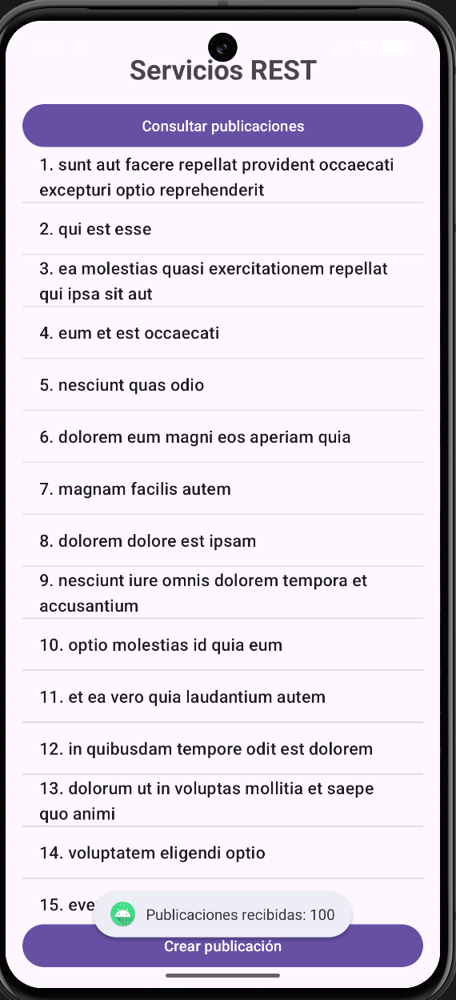
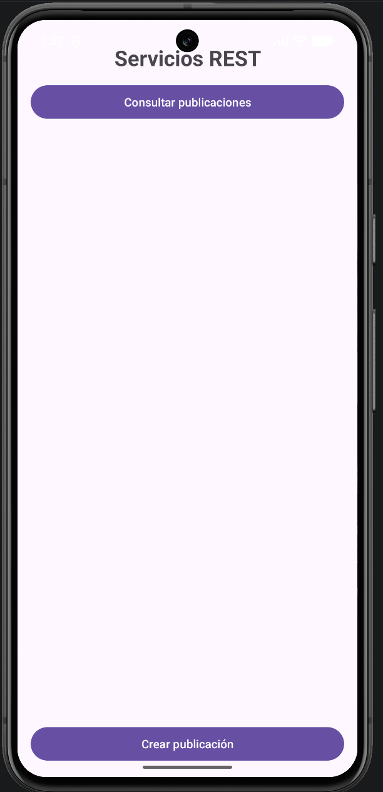
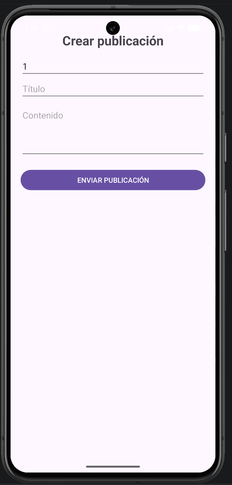
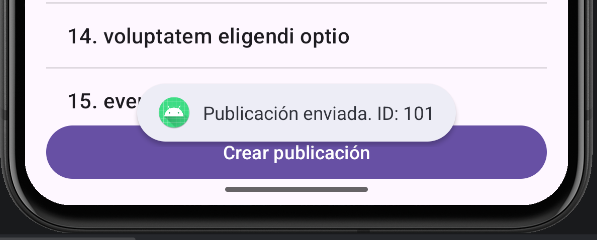
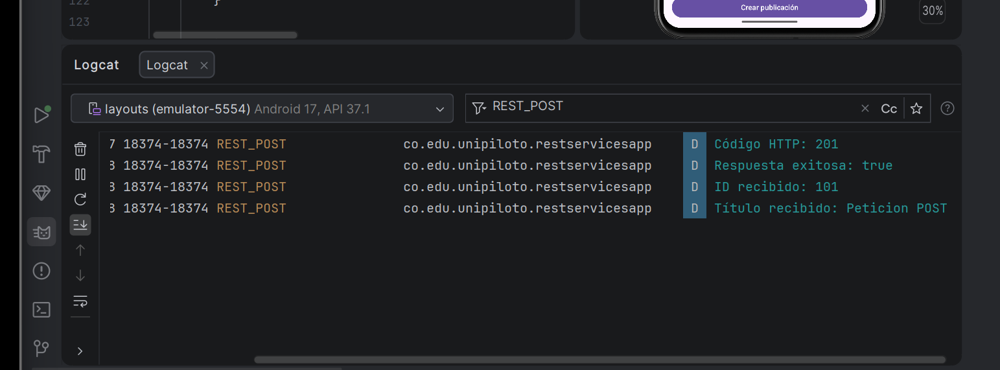

# RestServicesApp — Consumo de Servicios REST

## Descripción

**RestServicesApp** es una aplicación Android desarrollada en Java como parte del laboratorio **Servicios REST**, de la Universidad Piloto de Colombia.
El objetivo del proyecto es implementar un cliente Android capaz de consumir servicios REST mediante peticiones HTTP, utilizando **Retrofit** para la comunicación con el servidor y **Gson** para convertir las respuestas JSON en objetos Java.
La aplicación permite consultar publicaciones desde un servicio web y enviar nuevas publicaciones mediante un formulario.
Para las pruebas se utiliza [JSONPlaceholder](https://jsonplaceholder.typicode.com/), un servicio REST de prueba que permite experimentar con operaciones GET y POST.

## Objetivo del laboratorio

Crear un frontend Android para el consumo de servicios REST, implementando:
  - Una capa de comunicación con el servidor.
  - Una petición HTTP GET para consultar publicaciones.
  - Una petición HTTP POST para enviar una publicación.
  - Conversión de datos JSON a objetos Java.
  - Presentación de los datos recibidos en una lista.
  - Manejo de respuestas HTTP y errores de conexión.

## Tecnologías utilizadas

  - **Android Studio:** entorno de desarrollo.
  - **Java:** lenguaje de programación.
  - **XML:** diseño de las interfaces.
  - **Android SDK:** herramientas para desarrollar la aplicación.
  - **Retrofit 2.11.0:** cliente HTTP para consumir servicios REST.
  - **Gson 2.11.0:** conversión de datos JSON.
  - **Converter Gson 2.11.0:** integración de Gson con Retrofit.
  - **JSONPlaceholder:** API de prueba.
  - **Logcat:** verificación de las respuestas HTTP.

## Servicio REST utilizado

La aplicación consume el servicio JSONPlaceholder.

**URL base:**

```text
https://jsonplaceholder.typicode.com/
```

### Servicios implementados

| Método HTTP | Endpoint | Funcionalidad |
|---|---|---|
| GET | `/posts` | Consultar publicaciones. |
| POST | `/posts` | Enviar una nueva publicación. |

### Ejemplo de respuesta JSON

El servicio GET devuelve publicaciones con una estructura similar a esta:

```json
{
  "userId": 1,
  "id": 1,
  "title": "Mi primera publicación",
  "body": "Contenido de ejemplo"
}
```

La aplicación convierte esta respuesta en objetos Java de tipo `Post` mediante Gson.

> **Nota:** JSONPlaceholder es un servicio de pruebas. Las operaciones POST devuelven una respuesta simulada, pero los registros enviados no se almacenan permanentemente en el servidor.

## Arquitectura del proyecto

La aplicación se organiza en una capa de presentación, un modelo de datos y una capa de comunicación con el servidor.

```text
RestServicesApp
       │
       ▼
  MainActivity
       │
       ├────────────── GET ──────────────┐
       │                                 │
       ▼                                 ▼
  ListView                         ApiClient
                                         │
                                         ▼
                                    PostService
                                         │
                                         ▼
                                  JSONPlaceholder
                                         │
                                         ▼
                                    Respuesta JSON
                                         │
                                         ▼
                                       Gson
                                         │
                                         ▼
                                    Lista de Post

  MainActivity
       │
       ▼
FormularioActivity
       │
       ▼
  PostService
       │
       ├────────────── POST ─────────────┐
       │                                 │
       ▼                                 ▼
    Objeto Post                    JSONPlaceholder
                                         │
                                         ▼
                                  Respuesta HTTP
                                         │
                                         ▼
                                    Logcat / Toast
```

---

## Clases principales

### 1. `MainActivity.java`

Es la pantalla principal de la aplicación.

Sus responsabilidades son:

- Mostrar el botón **Consultar publicaciones**.
- Mostrar el botón **Crear publicación**.
- Ejecutar la consulta GET al presionar el botón correspondiente.
- Procesar la respuesta recibida del servidor.
- Mostrar los títulos de las publicaciones en un `ListView`.
- Abrir el formulario de creación de publicaciones.

### 2. `Post.java`

Es el modelo de datos que representa una publicación.

Contiene los atributos:

| Atributo | Tipo | Descripción |
|---|---|---|
| `userId` | `int` | Identificador del usuario. |
| `id` | `int` | Identificador de la publicación. |
| `title` | `String` | Título de la publicación. |
| `body` | `String` | Contenido de la publicación. |

Esta clase incluye constructores, getters y setters para acceder a los datos. Gson utiliza este modelo para convertir las respuestas JSON en objetos Java y viceversa.

### 3. `PostService.java`
Define los servicios REST utilizando las anotaciones de Retrofit. Los métodos implementados son:

```java
@GET("posts")
Call<List<Post>> obtenerPosts();

@POST("posts")
Call<Post> crearPost(@Body Post post);
```

- `obtenerPosts()` realiza la consulta de publicaciones.
- `crearPost()` envía un objeto `Post` al servidor.
- `@Body` indica que el objeto se envía en el cuerpo de la petición POST.

### 4. `ApiClient.java`

Centraliza la configuración de Retrofit.

Define la URL base del servidor y registra el convertidor Gson para procesar las respuestas JSON. La configuración utiliza:

```java
new Retrofit.Builder()
        .baseUrl("https://jsonplaceholder.typicode.com/")
        .addConverterFactory(
                GsonConverterFactory.create()
        )
        .build();
```

La clase proporciona el servicio `PostService` para que las actividades puedan realizar peticiones HTTP.

### 5. `FormularioActivity.java`

Permite capturar los datos de una nueva publicación.

Sus responsabilidades son:
  - Obtener el ID del usuario.
  - Capturar el título.
  - Capturar el contenido.
  - Validar que los campos estén completos.
  - Crear un objeto `Post`.
  - Enviar la publicación mediante POST.
  - Procesar la respuesta del servidor.
  - Mostrar mensajes de éxito o error.

## Implementación de GET

La operación GET permite recuperar publicaciones desde el servidor.

El método se define en `PostService.java`:

```java
@GET("posts")
Call<List<Post>> obtenerPosts();
```

Desde `MainActivity.java`, la consulta se ejecuta de forma asíncrona:

```java
postService.obtenerPosts().enqueue(
        new Callback<List<Post>>() {

            @Override
            public void onResponse(
                    Call<List<Post>> call,
                    Response<List<Post>> response
            ) {
                if (response.isSuccessful()
                        && response.body() != null) {

                    publicaciones.clear();

                    for (Post post : response.body()) {
                        publicaciones.add(
                                post.getId() + ". "
                                        + post.getTitle()
                        );
                    }

                    adapter.notifyDataSetChanged();
                }
            }

            @Override
            public void onFailure(
                    Call<List<Post>> call,
                    Throwable t
            ) {
                // Se informa el error de conexión.
            }
        }
);
```

### Flujo de la petición GET

```text
Usuario
   │
   ▼
Consultar publicaciones
   │
   ▼
MainActivity
   │
   ▼
PostService.obtenerPosts()
   │
   ▼
GET /posts
   │
   ▼
JSONPlaceholder
   │
   ▼
Respuesta JSON
   │
   ▼
Gson convierte los datos a Post
   │
   ▼
ArrayAdapter
   │
   ▼
ListView
```

### Resultado
La pantalla principal muestra los identificadores y títulos de las publicaciones recuperadas desde el servicio REST.

## Implementación de POST

La operación POST permite enviar una nueva publicación al servidor.

El servicio se define en `PostService.java`:

```java
@POST("posts")
Call<Post> crearPost(@Body Post post);
```

El formulario solicita los siguientes datos:

- ID del usuario.
- Título.
- Contenido.

Después de validar los datos, `FormularioActivity` construye el objeto:

```java
Post nuevaPublicacion =
        new Post(userId, titulo, contenido);
```

Posteriormente ejecuta la petición:

```java
postService.crearPost(nuevaPublicacion)
        .enqueue(new Callback<Post>() {

            @Override
            public void onResponse(
                    Call<Post> call,
                    Response<Post> response
            ) {
                if (response.isSuccessful()
                        && response.body() != null) {

                    Post creada = response.body();

                    // Procesar la respuesta recibida.
                }
            }

            @Override
            public void onFailure(
                    Call<Post> call,
                    Throwable t
            ) {
                // Procesar el error de conexión.
            }
        });
```

### Flujo de la petición POST

```text
Usuario
   │
   ▼
FormularioActivity
   │
   ▼
Validación de los campos
   │
   ▼
Creación del objeto Post
   │
   ▼
PostService.crearPost()
   │
   ▼
POST /posts
   │
   ▼
JSONPlaceholder
   │
   ▼
Respuesta HTTP
   │
   ▼
Objeto Post recibido
   │
   ▼
Mensaje de resultado
```

## Validación de datos

Antes de enviar la petición, el formulario comprueba que los campos estén completos. Si falta alguno, muestra el mensaje:
```text
Completa todos los campos
```
También verifica que el ID del usuario sea un número válido y mayor que cero. Estas validaciones evitan enviar una petición cuando los datos requeridos no han sido introducidos correctamente.

## Verificación de las peticiones

Para verificar el funcionamiento del servicio POST se añadieron registros de diagnóstico en Logcat.

La aplicación registra:

- Código HTTP recibido.
- Estado de éxito de la respuesta.
- ID devuelto por el servidor.
- Título recibido en la respuesta.
- Errores de conexión, cuando ocurren.

### Resultado observado

Durante las pruebas se obtuvo una respuesta similar a:

```text
REST_POST
Código HTTP: 201
Respuesta exitosa: true
ID recibido: 101
Título recibido: Peticion POST
```

El código HTTP `201` indica que el servidor respondió con el estado habitual de creación exitosa.

El identificador y el título recibidos permiten comprobar que la aplicación procesó el cuerpo de la respuesta del servicio.

**Importante:** esta evidencia demuestra la respuesta exitosa recibida. JSONPlaceholder simula la creación y no conserva permanentemente el registro.


## Pruebas realizadas

### Prueba 1. Consulta GET

**Procedimiento:**

1. Abrir la aplicación.
2. Presionar **Consultar publicaciones**.
3. Esperar la respuesta del servidor.

**Resultado esperado:**

La lista se llena con publicaciones obtenidas desde JSONPlaceholder.

**Estado:** satisfactorio.

### Prueba 2. Apertura del formulario

**Procedimiento:**

1. Abrir la pantalla principal.
2. Presionar **Crear publicación**.

**Resultado esperado:**

Se abre el formulario de captura.

**Estado:** satisfactorio.

### Prueba 3. Validación del formulario

**Procedimiento:**

1. Dejar uno o más campos vacíos.
2. Presionar **Enviar publicación**.

**Resultado observado:**

La aplicación solicita completar todos los campos y no continúa con el envío.

**Estado:** satisfactorio.

### Prueba 4. Envío POST

**Procedimiento:**

1. Introducir el ID del usuario.
2. Introducir un título.
3. Introducir el contenido.
4. Presionar **Enviar publicación**.

**Resultado observado:**

El servidor devuelve una respuesta HTTP exitosa y la aplicación muestra el ID recibido.

**Estado:** satisfactorio.

### Prueba 5. Verificación en Logcat

**Procedimiento:**

  1. Abrir Logcat en Android Studio.
  2. Filtrar los registros por `REST_POST`.
  3. Enviar una publicación desde la aplicación.
  4. Revisar el código HTTP y los datos recibidos.

**Resultado observado:**

Se registraron el código HTTP `201`, el estado exitoso y el ID y título de la publicación recibida.

**Estado:** satisfactorio.

## Evidencias

Las capturas de las pruebas se encuentran en la carpeta:

```text
EvidenciasREST/
```

### 1. Consulta de publicaciones

Archivo: `GET_Publicaciones.png`

Muestra la lista de publicaciones recuperadas desde el servicio REST mediante GET.



### 2. Menú principal

Archivo: `Menu.png`

Muestra la pantalla principal y los botones para consultar publicaciones y crear una publicación.



### 3. Formulario POST

Archivo: `POST_Formulario.png`

Muestra el formulario para introducir los datos de una nueva publicación.



### 4. Respuesta POST en la aplicación

Archivo: `POST_Respuesta.png`

Muestra el mensaje de confirmación con el identificador devuelto por el servicio.



### 5. Respuesta POST en Logcat

Archivo: `POST_Respuesta_log.png`

Muestra los registros técnicos del resultado de la petición, incluido el código HTTP y los datos recibidos.



## Estructura del proyecto

La estructura principal implementada es:

```text
RestServicesApp/
│
├── app/
│   └── src/
│       └── main/
│           ├── java/
│           │   └── co/
│           │       └── edu/
│           │           └── unipiloto/
│           │               └── restservicesapp/
│           │                   ├── MainActivity.java
│           │                   ├── FormularioActivity.java
│           │                   ├── Post.java
│           │                   ├── PostService.java
│           │                   └── ApiClient.java
│           │
│           ├── res/
│           │   └── layout/
│           │       ├── activity_main.xml
│           │       └── activity_formulario.xml
│           │
│           └── AndroidManifest.xml
│
├── EvidenciasREST/
│   ├── GET_Publicaciones.png
│   ├── Menu.png
│   ├── POST_Formulario.png
│   ├── POST_Respuesta.png
│   └── POST_Respuesta_log.png
│
├── README.md
└── archivos de configuración de Gradle
```

## Ejecución del proyecto

Para ejecutar la aplicación:

  1. Abrir `RestServicesApp` en Android Studio.
  2. Esperar la sincronización de Gradle.
  3. Comprobar que las dependencias estén instaladas.
  4. Iniciar un emulador Android o conectar un dispositivo.
  5. Ejecutar la aplicación mediante **Run**.
  6. Presionar **Consultar publicaciones** para probar GET.
  7. Presionar **Crear publicación** para abrir el formulario.
  8. Completar los campos y enviar la publicación para probar POST.

### Dependencias principales

En `build.gradle.kts` del módulo `app` se utilizan:

```kotlin
implementation("com.squareup.retrofit2:retrofit:2.11.0")
implementation("com.squareup.retrofit2:converter-gson:2.11.0")
implementation("com.google.code.gson:gson:2.11.0")
```

La aplicación también requiere el permiso de Internet en `AndroidManifest.xml`:

```xml
<uses-permission android:name="android.permission.INTERNET" />
```

## Relación con el entregable

| Requisito del laboratorio | Implementación |
|---|---|
| Crear un frontend Android para consumir servicios REST | `MainActivity` y `FormularioActivity` |
| Crear una capa de comunicación con el backend | `ApiClient.java` |
| Utilizar Retrofit | Configuración de Retrofit y `PostService.java` |
| Crear un servicio GET | `obtenerPosts()` |
| Crear un servicio POST | `crearPost()` |
| Procesar datos JSON | Gson y `Post.java` |
| Mostrar datos recibidos | `ListView` y `ArrayAdapter` |
| Capturar datos para enviar | `FormularioActivity` |
| Verificar las respuestas | Callbacks de Retrofit y Logcat |

## Autor

**Christian Lopez / Universidad Piloto de Colombia**
**Proyecto:** RestServicesApp
**Laboratorio:** Servicios REST
